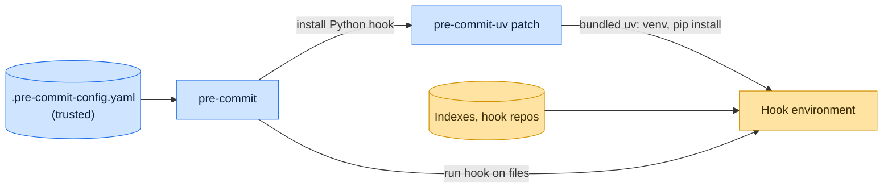

# Threat model

This model says what pre-commit-uv trusts, where untrusted input enters, and which guarantees hold at each boundary, so
a report can be classified as a vulnerability or a bug. [SECURITY.md](SECURITY.md) covers reporting; if the two
disagree, SECURITY.md wins and we fix this file.

## How pre-commit-uv works

Installed next to pre-commit, pre-commit-uv ships a `.pth` file that runs at every interpreter start in that environment
and patches pre-commit's Python language only when the running program is pre-commit (or `FORCE_PRE_COMMIT_UV_PATCH` is
set) and `DISABLE_PRE_COMMIT_UV_PATCH` is not. When pre-commit installs a Python hook, the patch creates the hook's
environment with `uv venv` and installs the hook package and `additional_dependencies` with `uv pip install`, using the
bundled `uv` with `--project` pointing at the repository root. Everything else, from cloning hook repositories to
running hooks, stays with pre-commit.

## Compared with similar tools

We drew the boundary where comparable projects in other ecosystems draw theirs. The shared rule, stated by the
[Node.js threat model](https://github.com/nodejs/node/blob/main/SECURITY.md#the-nodejs-threat-model), is that a report
which first needs a trusted element compromised is out of scope; the first triage question, as
[DOMPurify](https://github.com/cure53/DOMPurify/blob/main/SECURITY.md#what-we-consider-a-vulnerability) puts it, is what
the attacker controls.

| Project                                                              | Language | Where it draws the line                                                           |
| -------------------------------------------------------------------- | -------- | --------------------------------------------------------------------------------- |
| [pre-commit](https://github.com/pre-commit/pre-commit)               | Python   | The host tool runs whatever hooks the config pins; reports go through Tidelift.   |
| [Lefthook](https://github.com/evilmartians/lefthook/security/policy) | Go       | Runs the commands its configuration names by design; that is not a vulnerability. |
| [uv](https://github.com/astral-sh/uv/security/policy)                | Rust     | The installer pre-commit-uv delegates to.                                         |

## Trusted

An attacker who controls any of these already has what pre-commit-uv could give them:

- The user, `.pre-commit-config.yaml`, and the hook repositories and revisions it pins.
- pre-commit and the bundled `uv`.
- The configured package indexes, `UV_*` settings, and the repository's own uv configuration, which uv reads through
  `--project`.

## Untrusted inputs

| Input                     | Comes from                                                                   | What pre-commit-uv guarantees                                                                                                                 |
| ------------------------- | ---------------------------------------------------------------------------- | --------------------------------------------------------------------------------------------------------------------------------------------- |
| The program being started | Any Python process in the environment, since the `.pth` file runs at startup | The patch applies only when pre-commit itself is running or `FORCE_PRE_COMMIT_UV_PATCH` is set, and never with `DISABLE_PRE_COMMIT_UV_PATCH`. |

## Threats and controls

| STRIDE                 | Threat                                                                     | Control                                                                                  |
| ---------------------- | -------------------------------------------------------------------------- | ---------------------------------------------------------------------------------------- |
| Tampering              | The patch installs a hook package other than the one pre-commit requested. | It passes pre-commit's own package list to `uv pip install` unchanged.                   |
| Elevation of privilege | The patch loads into an unrelated program and changes how it installs.     | Startup check that the caller is pre-commit; `DISABLE_PRE_COMMIT_UV_PATCH` turns it off. |

## Release chain

Releases run on the shared [tox-dev/github-workflows](https://github.com/tox-dev/github-workflows) pipeline. A release
App, not a person, pushes the release commit and tag; the build installs its tools from a hash-checked `pylock.toml`
resolved with a seven-day upload cooldown by default; PyPI receives the files through
[trusted publishing](https://docs.pypi.org/trusted-publishers/) with attestations, and the GitHub Release is immutable.
Every workflow pins third-party actions to a commit SHA.

## Vulnerability or bug

| Report                                                                                   | Verdict             | Why                                          |
| ---------------------------------------------------------------------------------------- | ------------------- | -------------------------------------------- |
| `pre-commit-uv` installs an `additional_dependencies` entry that the config did not list | Vulnerability       | Install set must match pre-commit's request. |
| A pinned hook repository ships malware                                                   | Not a vulnerability | The config trusts its hooks.                 |
| uv picks a different Python than virtualenv would                                        | Bug                 | Behavior difference, no boundary crossed.    |

## Severity

- **High:** pre-commit-uv installs a package pre-commit did not request, or runs a `uv` other than the bundled one.
- **Medium:** the patch changes how an unrelated program installs, or activates despite `DISABLE_PRE_COMMIT_UV_PATCH`.
- **Low:** a crash or confusing error while setting up a hook environment.

## Accepted risks

- pre-commit-uv inherits pre-commit's trust in hook repositories.

## Keeping this current

Revisit this model when pre-commit-uv gains a new input source, network access, a new way to run code, or a new place it
writes to, and whenever an advisory is published.
